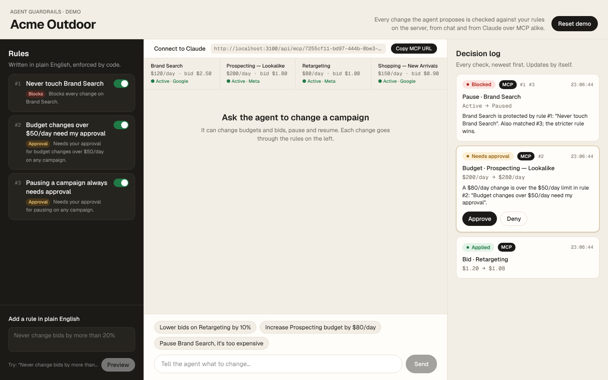

# Agent Guardrails for Ryze

Plain-English rules that every change the Ryze agent proposes is checked against **on the server**, whether the request comes from the web chat or from Claude over MCP.

**Live demo:** https://gregarious-cucurucho-e94372.netlify.app

**Why:** in Ryze's chat, Tool approvals default to *Skip all approvals* and the choice is stored in the browser ([Chat](https://help.get-ryze.ai/agent/chat.md), [Paid Ads FAQ](https://help.get-ryze.ai/paid-ads/faq.md)). Over MCP, approvals are set in the client's connector settings ([Permissions & Approvals](https://help.get-ryze.ai/claude/permissions.md)). There are no dollar thresholds or protected campaigns. This demo puts one rule set in the workspace and enforces it for every channel. Based on the public help center as of Nov 21, 2026.



## How it works

- `lib/rules/evaluate.ts` decides: a pure function, four rule types, strictest outcome wins (block > approval > allow). No LLM in the decision.
- `lib/actions/propose.ts` is the only write path: it reads the current value from the database, does the arithmetic, runs `evaluate()`, logs the decision, applies only on allow.
- The web chat agent (`lib/llm/agent.ts`) and the MCP server (`lib/mcp/server.ts`) both call it through the same tools in `lib/tools.ts`; the channel is set by the server, never by the model.
- Claude only translates a rule's text into JSON (structured output, validated with Zod) and explains verdicts. The "how it was understood" line is generated from that JSON by code.
- Approving re-checks the rules first, so a rule added after the request still wins.

## How it would plug into Ryze

Rules live in the workspace. `evaluate()` runs before every write tool in chat, MCP, the Agent API and scheduled tasks. *Needs approval* becomes a card in the existing Inbox, which already has before/after, evidence and revert.

**Next:** rules by role and by who asked in Slack, scheduled tasks, a total spend cap, limits per API key, OAuth instead of the workspace id in the MCP URL.

## Run locally

```bash
cp .env.example .env.local      # set DATABASE_URL and ANTHROPIC_API_KEY or OPENROUTER_API_KEY
npm install && npm run db:migrate
npm run dev                     # open http://localhost:3000
```

Tests: `npm test` (set `TEST_DATABASE_URL` to also run the Postgres tests).

**Connect Claude over MCP:** deploy (the `vercel-build` script runs migrations, also on Netlify), copy the MCP URL from the page, add it to Claude as a custom connector, then ask Claude to pause Brand Search. The block shows up in the decision log with an MCP badge.

Stack: Next.js (App Router), TypeScript, Postgres with Drizzle, Claude API through the Anthropic SDK (directly or via OpenRouter), MCP TypeScript SDK, Zod, Vitest.
